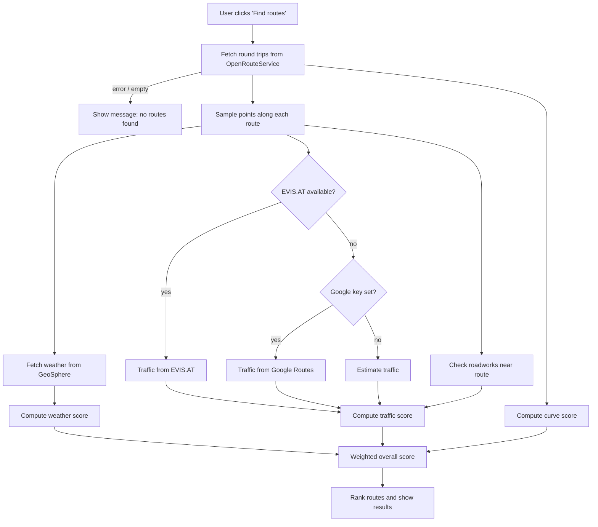

# RideScore

> **Which motorcycle loop is worth riding today?**
> RideScore suggests round trips from your start point and rates every route from 1 to 5 for
> **curves**, **weather** and **traffic** using open Austrian data APIs.

Course project (FHTW, Flet, built with Claude Code). Full brief: `RideScore_PROJECT.md`.

## Features
- Round-trip suggestions from a start point (address or `lat, lon`), length and start time
- Scores 1-5 for curves, weather, traffic + weighted overall score (your weights)
- Map (routes coloured by score, roadwork markers), grouped bar chart, elevation and temperature line charts
- Roadwork warnings that lower the traffic score
- Favourites and settings saved between sessions, GPX export
- Demo mode: works without any API key (generated routes and weather)

## Setup
Python 3.11+ (developed with 3.14).

```powershell
python -m venv .venv
.\.venv\Scripts\Activate.ps1
pip install -r requirements.txt
copy .env.example .env   # then add ORS_API_KEY (optional, see below)
```

## Run
```powershell
python src/main.py                 # desktop window
flet run --web src/main.py         # in the browser
python -m pytest                   # unit tests
```
Without `ORS_API_KEY` the app starts in **demo mode**. Get a free key at openrouteservice.org to use real routes.

## Data sources
| Source | Use | Status |
|---|---|---|
| OpenRouteService | round trips, elevation | implemented (needs key) |
| GeoSphere Austria Data Hub | hourly weather forecast (dataset `nwp-v2-1h-1km`; the old `nwp-v1-1h-2500m` is outdated and returns empty data), **CC BY 4.0 - credit GeoSphere Austria** | implemented and verified against the live API (no key needed); also used for the preview on the input screen |
| EVIS.AT | traffic state | **not connected yet** (access/format open) |
| Google Routes API | traffic fallback | implemented (needs key + billing) |
| ASFINAG / EVIS events | roadworks | **not connected yet** (demo roadworks in demo mode) |
| Own estimate | traffic fallback (weekday, hour, road type) | always available, shown as "estimated" |
| OpenStreetMap / Nominatim | map tiles, address search | (c) OpenStreetMap contributors |

Traffic order: EVIS.AT -> Google -> estimate. The UI always shows which source was used.

## Architecture
```
src/
  main.py        Flet app: screen controller only
  service.py     orchestrates "rate a route" (routes -> weather/traffic/roadworks -> scores)
  ui/            thin Flet views and chart builders (no API calls, no maths)
  logic/         pure functions: geo, curves, weather_score, traffic_score, ranking, gpx
  data/          API clients, http helper (timeout/retries), cache, storage, mock data
  models/        dataclasses
tests/           unit tests (logic, data layer, UI smoke test)
```

## Scoring (starting values, to be calibrated)
- **Curves:** heading change per km on a 100 m resampled track (changes < 1.5 degrees ignored). 30 deg/km -> 1, 180 deg/km -> 5. Bonus up to +0.5 for climbing (50 m/km), penalty up to -2 for motorway/main-road share.
- **Weather:** points every ~12 km at the time the rider passes. Rain (>= 0.1 mm/h) costs 2-4 points, temperature outside 15-27 deg C and wind > 25 km/h cost less. Route score = 60 % worst point + 40 % average.
- **Traffic:** congestion factor (1.0 free flow ... 1.6 heavy) mapped to 5..1, minus 0.7 per roadwork (max 2).
- **Overall:** weighted mean with the user's weights (missing weather is left out); ties broken by curve score.

## Error handling
Every request has a 10 s timeout and up to 3 retries (network errors, HTTP 429/5xx). Responses are validated; failing sources become notes in the UI, and the app falls back (traffic estimate, no weather) instead of crashing. Responses are cached for an hour.

## Flow chart - "Rate a route"


## Prompting strategy
See `docs/prompt_log.md`. One feature per prompt, mock data first, read all generated code, run the tests after each step.

## Division of work
TODO - write down who worked on which part (required).

## Known limitations
Austria only; no motorcycle profile in ORS (uses driving-car); EVIS.AT and roadwork data not connected; weather needs real-API verification; scoring thresholds are not calibrated yet.
